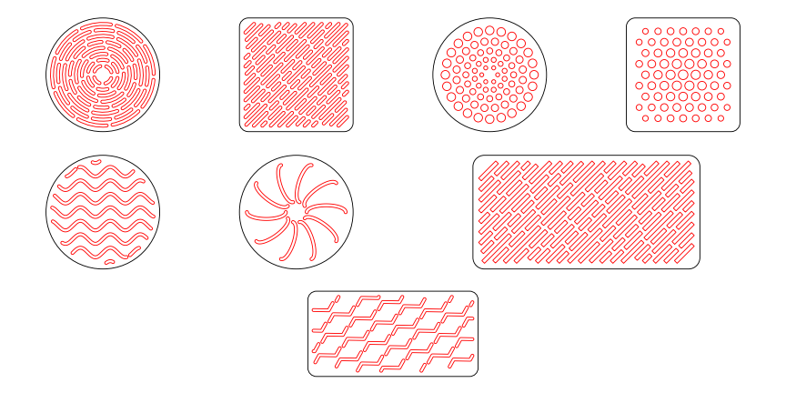

# Fan Vent Generator

> **This project was made entirely by AI.**
> All of the code, this README and the example files were written by AI (Claude, made by Anthropic).
> No human wrote or edited any of it. The repository owner only described what they wanted in a chat
> conversation and reviewed the results; every line of implementation came from the AI.

A browser-based, parametric generator for fan intake and exhaust vent patterns. Choose an outline, choose a
pattern, adjust every dimension, watch the drawing update live, and export a DXF (or SVG) ready for CAD,
3D printing or laser cutting.



## Outlines

| Outline | Parameters |
|---|---|
| Circle | Diameter, solid border |
| Square / rectangle | Width, height, corner radius, solid border |

The solid border is kept clear of cutouts on every pattern, including at rounded corners.

## Patterns

Any pattern works on any outline, except arc slots, which follow a circle and are only offered for circles.

### Arc slots (circle only)
Rings of curved slots around a solid centre hub, following the ring an axial fan actually moves air through.

| Parameter | Default | Description |
|---|---|---|
| Slot width | 1 mm | Radial width of every slot |
| Gap between rings | 1 mm | Material between rings |
| Min. spoke width | 1 mm | Material between neighbouring slots in a ring, measured edge to edge |
| Ring rotation | 21° | Extra turn per ring so spokes never line up |
| Min. centre hub Ø | 2 mm | Rings stop before this solid centre |
| Slot lengths | `11, 7, 9.5, 5.5, 8, 6.5, 4.5, 3.5` | Target length per ring, outer ring first; the list repeats |

### Straight slots
Parallel rows of slots at any angle, staggered so the ribs interlock.

| Parameter | Default | Description |
|---|---|---|
| Slot angle | 45° | 0–180°, counter-clockwise from horizontal; slider and presets |
| Slot ends | Round | Round (obround) or square (rectangular) |
| Slot width | 1 mm | Width of each slot |
| Gap between rows | 1 mm | Spacing between rows |
| Gap between slot ends | 1 mm | Material between slots in a row |
| Shortest edge slot | 2.5 mm | Shorter slots near the edge are removed |
| Stretch edge slots | On | Extend the neighbouring slot to the border instead |
| Slot lengths | `8, 4, 6, 10, 5` | Target length per row, centre row outward, mirrored |

### Graded holes
Round holes whose diameter changes with distance from the centre: bigger towards the edge, smaller towards
the edge, or constant.

| Parameter | Default | Description |
|---|---|---|
| Hole Ø at centre | 3 mm | Diameter at the centre |
| Hole Ø at edge | 1.2 mm | Diameter at the edge; larger than the centre value means holes grow outward |
| Size curve | 1 | Exponent of the change: 1 linear, 2 changes late, 0.5 changes early |
| Edge size reached at | Farthest point | The corners (or circle edge), or the nearest edge |
| Smallest hole kept | 0.8 mm | Holes below this diameter are left out |
| Arrangement | Concentric rings | Concentric rings, hexagonal grid or square grid |
| Min. material between holes | 1 mm | Guaranteed between neighbouring holes |
| Hole in the centre | On | Rings only |
| Solid centre Ø | 4 mm | Rings only, when there is no centre hole |
| Ring rotation | 0° | Rings only; extra turn per ring |

The diameter at distance *r* from the centre is
`d(r) = d_centre + (d_edge − d_centre) · (r / R)^curve`.
In the ring layout each ring's radius is solved so that it clears the previous ring by the minimum material,
and each ring gets as many holes as fit with that spacing.

### Custom line
Give the generator one line and it turns it into a pattern: the line gets a width, is repeated across the
outline, and is trimmed to the solid border.

**Getting a line in:**
- **Presets:** straight, wave, zigzag, chevron, arc, S-curve, square wave.
- **Draw it:** click to add points, drag to move them, double-click to delete; reverse and flip buttons.
- **Type or paste points:** `x, y` pairs, one per line.
- **Import a file:** DXF (LINE, ARC, LWPOLYLINE, POLYLINE, SPLINE; several entities are chained end to end)
  or SVG (`path`, `polyline`, `polygon` or `line`).

The line is rotated and scaled so its start and end points sit one motif length apart.

| Parameter | Default | Description |
|---|---|---|
| Slot width | 1 mm | Width given to the line |
| Slot ends | Round | Round or square ends |
| Motif length | 10 mm | Distance between the line's start and end |
| Height scale | 1× | Stretches the line sideways; 0 makes it straight |
| Shortest piece kept | 2 mm | Bits trimmed off at the border shorter than this are removed |
| Arrangement | Parallel rows | Parallel rows, or radial copies around the centre |
| Row spacing | 4.5 mm | Rows: centre-to-centre spacing |
| Gap between repeats | 0 mm | Rows: 0 joins copies into one continuous slot |
| Offset alternate rows | Off | Rows: shift every second row by half a repeat |
| Row angle | 0° | Rows: direction of the rows |
| Number of copies | 12 | Radial: copies around the centre |
| Start radius | 3 mm | Radial: where each copy starts |
| Rotation | 0° | Radial: turns the whole set |
| Mirror every second copy | Off | Flips alternate rows or copies |

If neighbouring slots touch, they are merged into one cutout and the page shows a warning.

### Checks
The page reports the number of cutouts and the open area, warns about ribs under 0.8 mm (thin for a 0.4 mm
nozzle), slots under 0.6 mm, holes under 1 mm (they print undersized on FDM printers) and borders under
0.8 mm, and lists every ring, row or piece in a breakdown table.

## Using it

- **Online:** publish with GitHub Pages (Settings → Pages → deploy from the `main` branch) and open the site.
- **Locally:** open `index.html` in a browser. No build step or server is needed; an internet connection is
  needed once for the fonts and the Clipper polygon library, both loaded from public CDNs.

### Export
- **DXF:** R12 ASCII, units in millimetres, layers `OUTLINE` and `CUTOUTS`. Slots are closed polylines (arcs
  stored as bulge values) and holes are `CIRCLE` entities, so they extrude or cut directly in Fusion 360,
  FreeCAD, Onshape, SolidWorks, LibreCAD or laser-cutter software. Custom-line slots are closed polylines
  with arcs approximated to within 4 µm.
- **SVG:** real-size (mm) drawing for Inkscape and laser cutters.
- **Copy DXF text:** puts the DXF on the clipboard.

## Examples

Ready-made files in [`examples/`](examples):

| File | Cutouts | Open area |
|---|---|---|
| `fan_vent_circle_38mm_arcs.dxf` | 62 | 37.6% |
| `fan_vent_square_38mm_slots_45deg.dxf` | 93 | 34.9% |
| `fan_vent_rect_60x30mm_rectslots_45deg.dxf` | 111 | 36.0% |
| `fan_vent_circle_38mm_holes_growing.dxf` | 78 | 29.1% |
| `fan_vent_square_38mm_holes_shrinking_hex.dxf` | 67 | 23.3% |
| `fan_vent_circle_38mm_line_wave.dxf` | 11 | 22.5% |
| `fan_vent_circle_38mm_line_radial_arc.dxf` | 10 | 13.6% |
| `fan_vent_rect_60x30mm_line_zigzag.dxf` | 31 | 17.3% |

Regenerate them with Node.js:

```sh
npm install
npm run examples
```

## Using the geometry in your own code

`src/gen.js` works in the browser (as `window.VentGen`, after loading `clipper-lib`) or in Node.js:

```js
const G = require("./src/gen.js");

const g = G.generate({
  shape: "circle", D: 60, margin: 2,
  pattern: "holes", layout: "rings", dCenter: 1.5, dEdge: 4, curve: 1,
  web: 1.2, minD: 1, centerHole: true, hub: 0, twist: 0, gradTo: "far",
});

console.log(g.count, "holes,", (100 * g.area / g.outlineArea).toFixed(1) + "% open");
require("fs").writeFileSync("vent.dxf", G.toDXF(g));
```

`generate(options)` returns the outline, the cutouts (`polys` as closed bulged polylines, `circles` as
centre and radius), the open area, per-ring/row details and any warnings. `toDXF(geometry)` and
`toSVG(geometry)` export them; `parseDXFLine(text)` and `presetLine(name)` provide lines for the custom
line pattern.

## Design notes

- **Round slot ends** avoid sharp inside corners, where cracks start in printed and moulded parts.
  **Square ends** suit laser-cut sheet; on a CNC router they come out with the cutter's corner radius.
- **Staggered rows and rotated rings** keep the ribs connected in both directions, which is stiffer and
  quieter than long parallel bars with the same open area.
- **Graded holes** let you put the most open area where the fan blades move the most air (towards the
  edge) while keeping the centre, which sits in front of the motor hub, stiff.
- **Clearance:** leave roughly 3–5 mm between a grille and small fan blades to avoid tonal whine.
- Slots and holes are placed with signed distance functions for the outline, so every cutout respects the
  solid border at any angle. Custom lines are trimmed and offset with the Clipper library.

## Project layout

```
index.html                    the generator page
src/gen.js                    outlines, patterns, line import, DXF and SVG export
scripts/generate-examples.js  regenerates the example files
examples/                     example DXF and SVG files and the preview image
package.json                  Node dependency (clipper-lib) for the example script
```

## References

- [Autodesk DXF Reference](https://help.autodesk.com/view/OARX/2024/ENU/?guid=GUID-235B22E0-A567-4CF6-92D3-38A2306D73F3): POLYLINE, VERTEX, CIRCLE and SPLINE entities, bulge (group 42)
- [ezdxf: bulge values](https://ezdxf.readthedocs.io/en/stable/concepts/bulge.html): how arcs are stored in polylines
- [Inigo Quilez: 2D distance functions](https://iquilezles.org/articles/distfunctions2d/): rounded box SDF used for trimming
- [Clipper by Angus Johnson](https://www.angusj.com/clipper2/Docs/Overview.htm): polygon clipping and offsetting (the JavaScript port of Clipper 1 is used here)
- [The NURBS Book, Piegl & Tiller](https://link.springer.com/book/10.1007/978-3-642-59223-2): de Boor's algorithm used for DXF spline import
